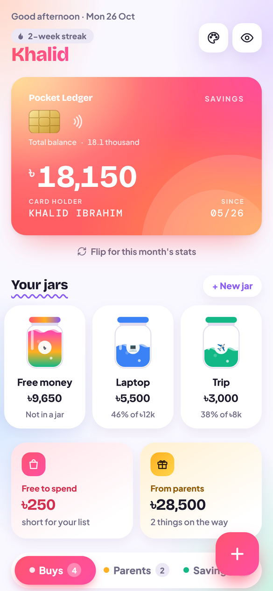
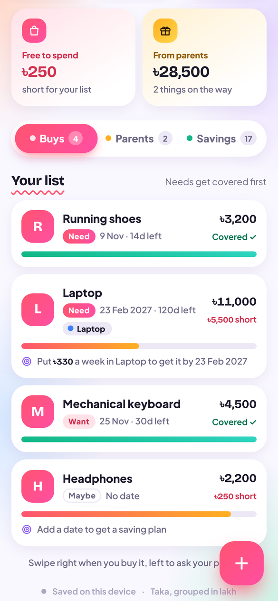
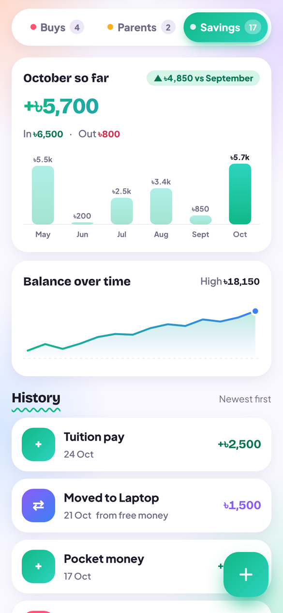
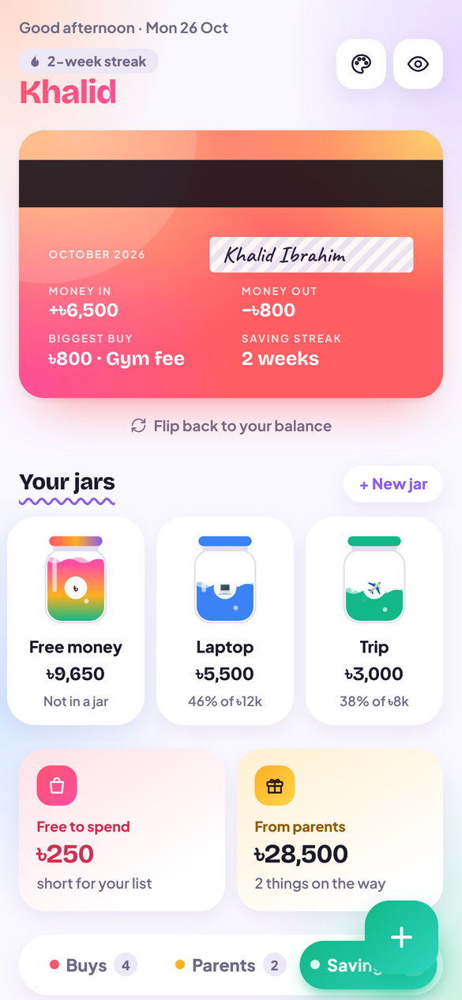

# Pocket Ledger

A colorful money app for Android: a flippable savings card, savings jars, a buy list, a "parents are buying" list and monthly stats, all in taka.

**[⬇ Download the APK](../../releases/latest)** · **[▶ Try it in your browser](https://khalidoibrahim.github.io/my-money-app/)**

<p>
  
  
  
  
</p>

## Features

- **Savings card** – total balance with a rolling counter; flip it for this month's money in, money out, biggest buy and saving streak
- **Jars** – set money aside for goals and watch them fill up
- **Buys** – plan what you want; savings cover needs first, with a daily or weekly saving plan for each item. Swipe right when bought, left to ask your parents
- **Parents** – track what you asked for: Asked → Promised → Got it
- **Savings** – log money in and out, move money between jars, see a 6-month chart and your balance over time
- Item photos, light and dark mode, and a button to hide amounts

All data stays on your phone. There are no accounts and no network calls.

## Download

Download **PocketLedger.apk** from the [latest release](../../releases/latest) and open it on an Android phone running Android 7 or newer. Allow "Install unknown apps" when asked. If Play Protect offers to scan the app, let it scan, then install.

The APK is signed with Android's official `apksigner` and asks for no permissions.

## Built with

HTML, CSS and JavaScript, packaged for Android with [Capacitor](https://capacitorjs.com). Each push to `main` builds, signs, verifies and publishes the APK with GitHub Actions.

To keep the same signing key across updates (so new versions install over old ones), add two repository secrets: `KEYSTORE_B64` (a base64-encoded keystore with key alias `release`) and `KEYSTORE_PASS`. Without them, each build is signed with a fresh key, so uninstall the old version before installing a new one.

```
www/                     the app (also published as the browser version)
docs/screenshots/        README screenshots
icons/                   launcher icons
scripts/                 build helpers (bundles fonts for offline use)
.github/workflows/       APK build, signing and release
```
